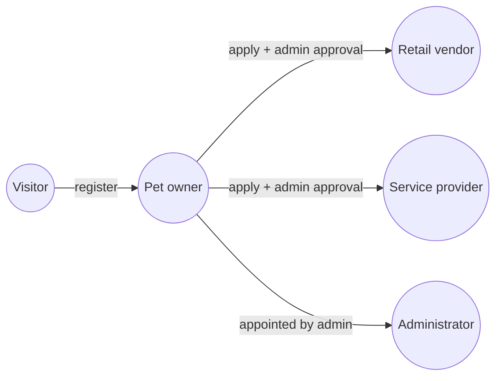
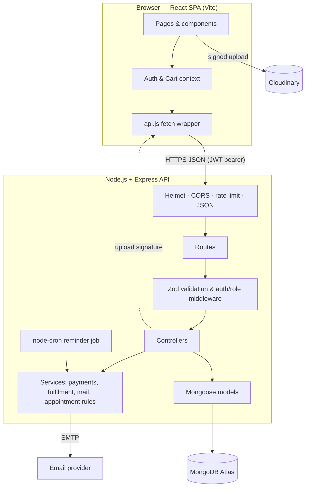
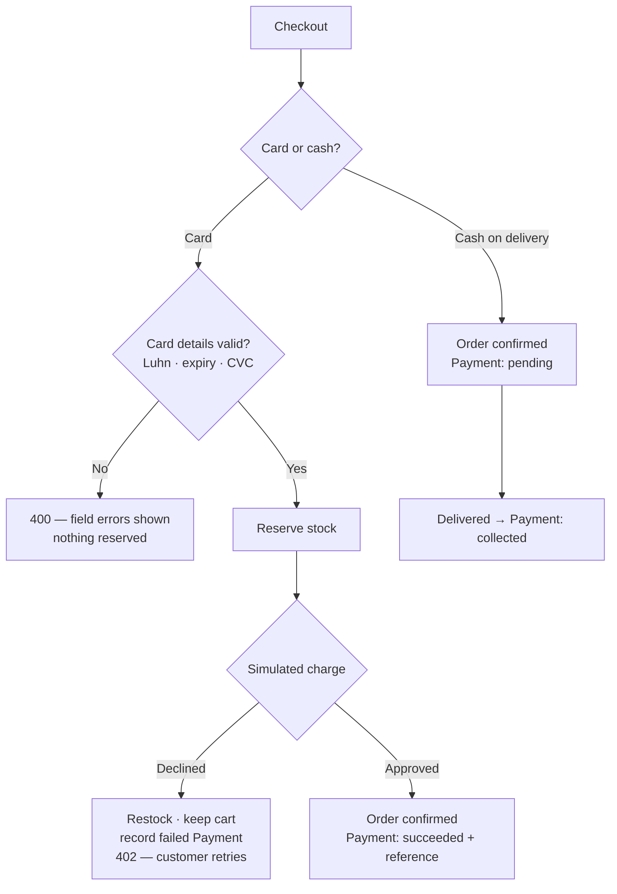
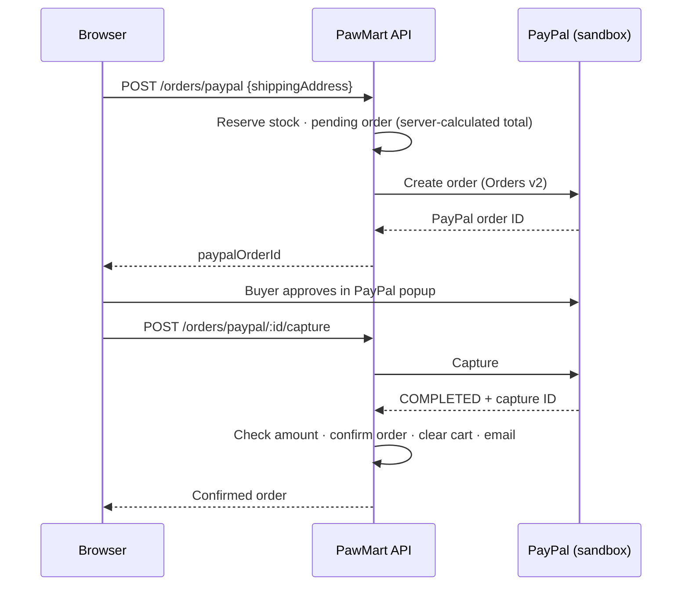
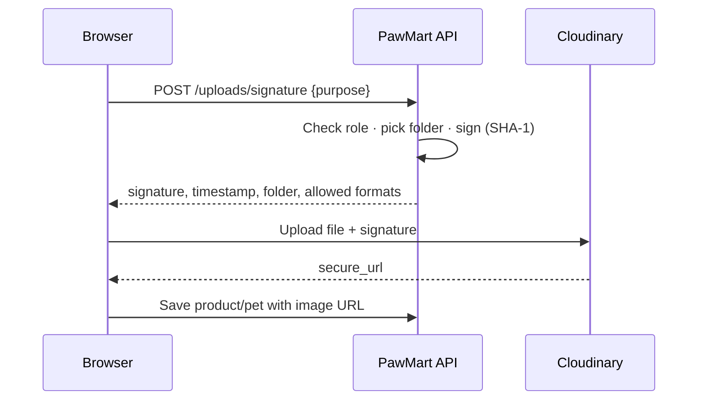
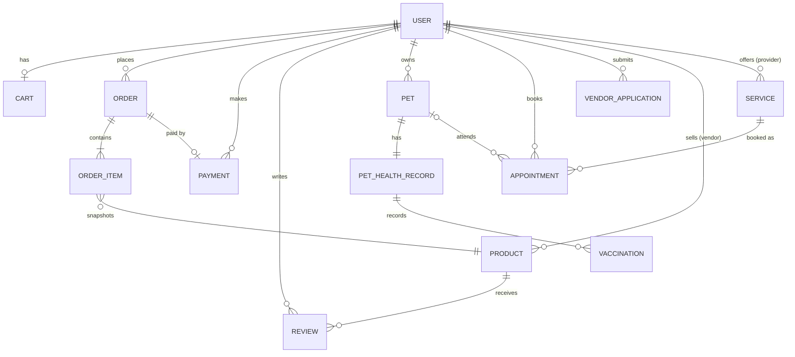

# PawMart — Project Report

**A One-Stop Web Marketplace for Pet Products & Pet Care Services**

| | |
|---|---|
| **Group** | Group 17 |
| **Team** | V. Prashoharan · Bashini Rashmika Vindyani · J.P. Inuka Sithanja Jayasinghe · D.S.N. Vitharana · B.R.G.S. Sandaruwan |
| **Repository** | [github.com/PrashoHaran/PawMart](https://github.com/PrashoHaran/PawMart) |
| **Report date** | October 2026 |
| **Status** | All proposed features implemented; deployment and automated tests remaining |

---

## Table of Contents

1. [Executive Summary](#1-executive-summary)
2. [Problem Statement and Objectives](#2-problem-statement-and-objectives)
3. [Users and Roles](#3-users-and-roles)
4. [System Architecture](#4-system-architecture)
5. [Technology Stack](#5-technology-stack)
6. [Functional Modules](#6-functional-modules)
7. [Data Model](#7-data-model)
8. [API Design](#8-api-design)
9. [Frontend Design](#9-frontend-design)
10. [Security](#10-security)
11. [Non-Functional Qualities](#11-non-functional-qualities)
12. [Configuration and Setup](#12-configuration-and-setup)
13. [Testing and Quality Assurance](#13-testing-and-quality-assurance)
14. [Team Responsibilities](#14-team-responsibilities)
15. [Comparison with the Proposal](#15-comparison-with-the-proposal)
16. [Limitations and Future Work](#16-limitations-and-future-work)
17. [Deployment Plan](#17-deployment-plan)
18. [References](#18-references)
19. [Appendix](#19-appendix)

---

## 1. Executive Summary

PawMart is a full-stack web application that brings together three things pet owners currently do on separate platforms: **buying pet products**, **booking pet care services**, and **keeping track of their pets' health**. A rule-based **Smart Pet Care Assistant** adds breed-specific feeding and care guidance.

The system is built on the MERN stack — **MongoDB Atlas, Express, React and Node.js** — with Tailwind CSS for styling. It supports four kinds of users (pet owners, retail vendors, service providers and administrators), each with their own dashboard.

| Measure | Value |
|---|---|
| Frontend pages (routes) | 11 |
| REST API endpoints | ~70 across 14 resource groups |
| Database collections | 11 |
| Backend source | 81 files, ~4,500 lines (JavaScript, ES modules) |
| Frontend source | 44 files, ~6,350 lines (React JSX) |
| Breed profiles in the Smart Assistant | 23 (16 dog, 7 cat) |

Every feature in the original proposal is implemented and working against a live MongoDB Atlas database. The remaining work is cloud deployment (Render + Vercel) and an automated test suite.

---

## 2. Problem Statement and Objectives

### 2.1 Problem

Pet owners in Sri Lanka typically use **separate, disconnected platforms**: one site for food and accessories, social media or phone calls to reach a vet or groomer, and memory or paper notes for vaccination dates. This causes friction when booking services and makes it easy to miss vaccinations.

### 2.2 Objectives (from the proposal) and how they were met

| Objective | How PawMart meets it |
|---|---|
| **Consolidate care** — bridge pet retail and professional services in one portal | One application with a marketplace, service booking, pet health records and an assistant, sharing one account |
| **Automate logistics** — background alerts for vaccine schedules | A daily background job (node-cron) emails owners before vaccines are due; order and appointment emails are automatic |
| **Innovate feasibly** — rule-based assistive logic | The Smart Pet Care Assistant uses veterinary formulas and a breed rule set — no paid AI service |
| **Operational MVP** — functional multi-role platform | Four roles with dedicated dashboards, all backed by the real API and database |
| **Stable, cost-free infrastructure** | MongoDB Atlas free tier, Cloudinary free tier, simulated payments; deployment targets Render and Vercel free tiers |

---

## 3. Users and Roles



| Role | Can do |
|---|---|
| **Visitor** (signed out) | Browse products and reviews, see services and free time slots, use the Smart Assistant |
| **Pet owner** (`customer`) | Shop and check out, review purchased products, manage pets and health records, book appointments, track and cancel orders and bookings |
| **Retail vendor** (`vendor`, `retail_vendor`) | Manage their products and images, fulfil orders for their products, view sales statistics |
| **Service provider** (`vendor`, `service_provider`) | Manage bookable services and schedules, handle bookings (cancel, complete, no-show), view earnings |
| **Administrator** (`admin`) | Everything in the Admin Hub: users, applications, products, orders, appointments, alerts, reports |

Vendors and service providers apply through a form; an administrator approves or rejects the application. The first administrator is created with a command-line script (`npm run make-admin`); after that, admins can appoint others from the dashboard.

---

## 4. System Architecture

### 4.1 Overview

PawMart is a **single-page application** talking to a **REST API**. The browser never talks to the database directly.



### 4.2 Backend layers

Requests pass through the same layers every time:

1. **Global middleware** — security headers (Helmet), CORS restricted to the frontend origin, rate limiting, JSON parsing, request logging.
2. **Route** — maps the URL to a handler.
3. **Validation and access control** — Zod schemas check the body/query; `requireAuth`, `requireRole` and `requireServiceProvider` check the user.
4. **Controller** — the endpoint's logic.
5. **Services** — shared business rules (payment gateway, order fulfilment, appointment outcomes, email).
6. **Models** — Mongoose schemas and indexes over MongoDB.
7. **Error handler** — one place converts every error into a consistent JSON response.

Every response has the same envelope, so the frontend handles all endpoints the same way:

```jsonc
{ "data": { ... }, "meta": { "page": 1, "per_page": 20, "total": 42 } }   // success
{ "error": { "code": "VALIDATION_ERROR", "message": "...", "details": [ ... ] } }   // failure
```

### 4.3 Frontend structure

- **React Router** maps 11 URLs to page components; a shared Navbar and Footer wrap every page.
- **AuthContext** keeps the signed-in user and JWT (persisted in `localStorage` and verified on reload). **CartContext** keeps the server-side cart in sync.
- Pages fetch their own data through one `apiRequest()` helper, which adds the token, parses the response envelope and signs the user out on a `401`.
- Larger screens are split into small components (`components/dashboard`, `orders`, `provider`, `admin`).

---

## 5. Technology Stack

### 5.1 Overview

| Layer | Technology | Version | Why it was chosen |
|---|---|---|---|
| UI library | React | 19 | Component model, large ecosystem, team familiarity |
| Build tool | Vite | 8 | Fast dev server and builds |
| Routing | React Router | 7 | Standard client-side routing |
| Styling | Tailwind CSS | 3 | Consistent responsive design without a paid UI kit |
| Icons | lucide-react | 1.x | Lightweight, consistent icon set |
| Linting | oxlint | 1.x | Fast linter with React rules (hooks rules as errors) |
| Runtime | Node.js | 24 (LTS-compatible) | JavaScript on both client and server |
| Web framework | Express | 4 | Lightweight, well-documented REST framework |
| Database | MongoDB Atlas | — | Flexible documents for varied products and pet records; free tier |
| ODM | Mongoose | 8 | Schemas, validation, indexes, population |
| Validation | Zod | 3 | Declarative request validation with clear error messages |
| Auth | jsonwebtoken + bcryptjs | 9 / 2 | Stateless JWT sessions; salted password hashing |
| Google sign-in | Google Identity Services + google-auth-library | 10.9.1 | Official "Sign in with Google" button; server-side ID-token verification |
| Security | Helmet, cors, express-rate-limit | 7 / 2 / 7 | Security headers, origin restriction, abuse protection |
| Email | Nodemailer | 10.0.12 | SMTP email from Node without a paid service |
| Scheduling | node-cron | 4.6.0 | Daily background job inside the API process |
| Images | Cloudinary | REST API | Free image hosting, resizing and format conversion |
| Payments | PayPal Checkout (sandbox) + simulated card gateway (own code) | Orders v2 REST API | Real PayPal flow with test money; simulated cards for offline demos |

### 5.2 Dependency choices worth noting

- **Nodemailer 10.0.12** and **node-cron 4.6.0** are pinned exactly. Nodemailer 6 has published security advisories and node-cron 3 depends on a flagged package, so newer fixed versions were chosen — but releases only a few days old were avoided.
- **Cloudinary needs no SDK.** Upload signatures are a SHA-1 hash computed with Node's built-in `crypto`; the implementation was verified to produce exactly the same signatures as Cloudinary's official SDK.

---

## 6. Functional Modules

Each module below lists what it does, the key business rules, and where it lives.

### 6.1 Authentication and Authorisation

- Register with name, email and password (8–72 characters); log in; restore the session on reload.
- Passwords are hashed with **bcrypt** (10 rounds); sessions are **JWTs** valid for one day.
- Each token carries a `tokenVersion`; increasing it on the server **invalidates every existing session** for that user (used when roles change or an account is suspended).
- Role checks happen on the server for every protected endpoint; the UI also hides links (e.g. **Admin** and **Vendor Portal**) from users who can't use them.
- Suspended users are rejected at login (`403`) and on every request (`401`).
- **Sign in with Google:** Google's official button returns a signed ID token, which the server verifies with `google-auth-library` (signature, expiry, issuer, audience = PawMart's client ID; verified email required). Users are matched by their Google account ID; a new Google user becomes a customer without a password. An existing password account with the same email is linked only when Google is authoritative for the address (Gmail or a Google Workspace domain) — otherwise the user must sign in with their password, which prevents account takeover. The same roles, suspension rules and dashboards apply.

### 6.2 Marketplace and Products

- Product list with **category filter**, **text search** (MongoDB text index, debounced in the UI) and pagination.
- Product detail page with price, stock, features and reviews.
- Products hidden by an admin, or sold by a suspended vendor, are removed from the marketplace, product pages, cart, checkout and assistant suggestions.
- Images are served through Cloudinary transformations (`c_limit,w_<n>,f_auto,q_auto`), so each view loads a resized, compressed image.

### 6.3 Reviews and Ratings

- Only customers with a **confirmed order containing the product** can review it, **once per product** (enforced by a unique index).
- Star rating 1–5 with an optional comment (up to 1,000 characters).
- The product's `rating` and `reviewCount` are **recalculated with a database aggregation** after every new or deleted review.
- Authors and admins can delete reviews. Vendors can no longer set their own product rating.

### 6.4 Cart and Checkout

- One **server-side cart per user** (no guest cart); quantities can be changed or removed.
- Checkout calculates **8% tax** and **$5.99 shipping (free over $50)** on the server.
- Stock is decremented **atomically** per item with a `stock >= quantity` guard; if any item is short, earlier decrements in the same request are rolled back and no order is created.

### 6.5 Simulated Payment

The proposal specified a simulated payment module instead of a real gateway. PawMart implements one that behaves like a real gateway:



- Card numbers are checked with the **Luhn algorithm**; expiry must be a future `MM/YY`; the CVC must be 3 digits (4 for Amex). Brand (Visa, Mastercard, Amex) is detected from the number.
- **Test cards** reproduce real decline reasons: declined, insufficient funds, expired card, incorrect CVC.
- Every attempt is stored in the **Payment** collection, but only the **card brand and last four digits** — never the full number or CVC.
- Cancelling a card-paid order marks the payment **refunded**; cash-on-delivery payments are **collected** on delivery.

**PayPal Checkout (sandbox).** Alongside the simulated card and cash on delivery, customers can pay through **PayPal's real checkout in sandbox mode** (test money only):



- The total is always calculated on the server, and the captured amount is checked against it before the order is confirmed.
- If PayPal declines the buyer's funding source, the order stays open and PayPal lets the buyer choose another method; if the buyer closes the popup, the reserved stock is released.
- A background job releases checkouts abandoned for 30 minutes — or confirms them if PayPal shows they were paid.
- Cancelling a PayPal-paid order issues a real **sandbox refund** through PayPal.
- Unpaid orders are hidden from vendors and excluded from revenue; the PayPal option only appears when credentials are configured.

### 6.6 Order Management

- Each order item has its own status: **confirmed → processing → shipped → delivered** (or cancelled). An order can contain products from several vendors, so **each vendor fulfils only their own items**; the order's overall status is its **least advanced item**.
- Seeded PawMart products have no vendor and are fulfilled by **admins**, who can also move any order forward.
- Customers can **cancel** until something has shipped: stock is restored and card payments refunded. Admins can cancel any order before delivery.
- Every status change is kept in a **status history**; customers are emailed when an order ships, is delivered or is cancelled.
- Customers see a **progress tracker** with per-item statuses; vendors and admins get filterable order lists with one-click "Mark Processing / Shipped / Delivered".
- Vendor sales statistics exclude cancelled orders.

### 6.7 Vendor Management

- Customers apply with a business name and type (**retail vendor** or **service provider**).
- Admins see all applications with their history (who reviewed them and when) and approve or reject them.
- On approval the user becomes a vendor of that type; their next sign-in shows the right dashboard.
- Retail vendors manage products (name, price, stock, category, image upload, description) and see sales, orders and active product counts.

### 6.8 Service Providers and Appointment Booking

- **Service providers** (vets, groomers) have their own **Provider Portal**: create services with price, duration, **open days** and **start times**; hide or remove services (services with booking history are hidden, not deleted).
- **Customers** see each service's provider and open days; after choosing a date, they see only **free time slots** (booked or past slots are crossed out).
- Booking rules: the day must be open, the slot must be offered, the time must be in the future, the slot must be free, and a provider **can't be double-booked across their own services**. Bookings can be linked to a saved pet.
- Providers see each booking's customer, pet (including allergies) and notes. Before the start time they can **cancel with a reason** (emailed to the customer); afterwards they mark it **completed** or **no-show**. Customers can cancel upcoming bookings, which frees the slot.
- Times are interpreted in **Sri Lanka time (UTC+05:30)**, configurable with `APP_UTC_OFFSET`, so bookings stay correct when the server runs in another timezone.
- The two seeded **PawMart Clinic** services are run by admins.
- Emails: booking confirmation to the customer; new-booking and cancellation notices to the provider.

### 6.9 Pet Profiles and Health Records

- **Pet profile**: name, species, breed, sex, birth date (age is calculated), weight, allergies and photo.
- **Health record** (one per pet, matching the proposal's ERD): vaccination history, medical conditions and notes.
- Each vaccination is labelled **overdue**, **due soon** (within 30 days) or **up to date**. Only the **latest dose of each vaccine** counts, so a booster that's already been given doesn't leave an old due date showing as overdue.
- The dashboard overview warns about pets with vaccines overdue or due soon.
- Pets are private: other users get "not found".

### 6.10 Notifications and Vaccination Reminders

| Email | Sent when | Recipient |
|---|---|---|
| Order confirmation | Checkout succeeds | Customer |
| Order shipped / delivered / cancelled (with refund note) | Status changes | Customer |
| Booking confirmation | Appointment booked | Customer |
| New booking / customer cancelled | Appointment booked or cancelled by the customer | Service provider |
| Appointment cancelled by provider (with reason) | Provider or admin cancels | Customer |
| Vaccination reminder | Daily job finds vaccines due within 7 days or overdue | Pet owner |

- Emails use **HTML and plain-text** versions with escaped user content.
- A failed email **never fails the action** that triggered it.
- The reminder job runs **daily at 08:00 Sri Lanka time** (configurable). It sends **one email per pet per due date**; changing a due date re-arms the reminder, and failed sends are retried the next day.
- Admins can run the reminder job **on demand** — useful for demos and on free hosting that sleeps.
- Without SMTP settings, emails are **printed to the server console**, so the project runs with no email account.

### 6.11 Smart Pet Care Assistant

A rule-based assistant (no AI service) that produces a care plan for a dog or cat.

**Inputs:** species, breed (free text), age, weight, spayed/neutered, activity level, allergies — or one click on a saved pet.

**Calorie calculation** (Merck Veterinary Manual):

> Resting Energy Requirement (RER) = 70 × weight(kg)^0.75
> Daily calories = RER × life-stage factor

| Life stage / condition | Dog | Cat |
|---|---|---|
| Young (puppy under 4 months / kitten) | 3.0 | 2.5 |
| Growing puppy (to 12 months; 18 months for large breeds) | 2.0 | — |
| Intact adult | 1.8 | 1.4 |
| Neutered adult | 1.6 | 1.2 |
| Obesity-prone or low activity | 1.4 | 1.0 |
| Very active adult | base + 0.4 | base + 0.2 |

Overweight adults are fed for the **top of their breed's healthy range**, with advice to check with a vet before dieting.

**Breed knowledge:** 23 profiles — Labrador, Golden Retriever, German Shepherd, Rottweiler, Doberman, Beagle, Dachshund, Pug, French Bulldog, Shih Tzu, Pomeranian, Siberian Husky, Boxer, Poodle, Cocker Spaniel, **Sinhala Hound / Sri Lankan local dog**; Persian, Siamese, Maine Coon, Ragdoll, British Shorthair, Bengal, domestic/mixed cat. Each profile has:

- Healthy adult weight range (shown as a gauge), exercise minutes and grooming level.
- **Heat sensitivity**, with tropical-climate advice for flat-faced and thick-coated breeds.
- **"Ask your vet about"** watch-outs, with sources for research-backed claims (for example, the POMC gene in about a quarter of Labradors, heatstroke risk in flat-faced breeds, heart disease in Dobermans and in HCM-prone cat breeds).
- Care tips and **product tags** used to pick catalogue products with a reason ("Supports joints", "Encourages drinking").

**Breed matching** accepts nicknames ("GSD", "Alsatian", "sausage dog", "moggy", "village dog") and typos ("Labardor", "beagel"). Unknown breeds fall back to general advice and list the breeds that are covered. Products for the other species, and products matching the pet's allergies, are excluded. Every plan shows how it was calculated, its sources, and the disclaimer *"General husbandry guidance only — not a veterinary diagnosis."*

### 6.12 Image Uploads (Cloudinary)



- Files go **straight from the browser to Cloudinary**; they never pass through the server, and the API secret never reaches the browser.
- Uploads are limited to **JPG, PNG and WebP** (enforced by Cloudinary through the signature) and **5 MB** (checked in the browser). Each purpose has a fixed folder; tampering with the folder invalidates the signature.
- Product images: vendors and admins. Pet photos: any signed-in user, in their own folder.
- Without Cloudinary settings, forms fall back to an image-URL field.

### 6.13 Admin Hub

| View | Functions |
|---|---|
| **Platform Health** | Totals (users and suspended, vendors and pending applications, orders and revenue, active bookings); **real alerts** — pending applications, out-of-stock and low-stock products, clinic visits needing an outcome, orders unprocessed after 2 days, email/upload/reminder configuration warnings — each linking to the right view; "Send vaccine reminders now" |
| **Orders** | All orders with status filter; advance, cancel and refund |
| **Manage Users** | Search and filter; **suspend** with a reason (signs the user out, blocks login, hides their products and services) and reactivate; appoint or remove admins (cannot change your own account or remove the last admin) |
| **Vendor Verification** | All applications with status filter, reviewer and dates; approve or reject |
| **Products** | All products with seller, stock and visibility filters; **hide/unhide with a reason** shown to the vendor; add, edit and delete PawMart's own catalogue (vendors' products stay under their control) |
| **Appointments** | All bookings; "PawMart Clinic only" and "needs outcome" filters; complete, no-show or cancel with a reason |
| **Analytics Reports** | Last 7/30/90 days or 12 months: revenue, orders, average order, appointments, new users; revenue chart (with keyboard-accessible tooltips and a table view); top products; orders by status and payment method; appointments by status and type; sign-ups by role |

---

## 7. Data Model

### 7.1 Entity relationships



`ORDER_ITEM` and `VACCINATION` are **embedded sub-documents** (stored inside their parent), which suits MongoDB: they're always read with their parent and never on their own.

### 7.2 Collections

| Collection | Key fields | Notable rules and indexes |
|---|---|---|
| **users** | name, email, passwordHash, role, businessName, businessType, status, tokenVersion | Unique email; password never returned |
| **products** | name, priceCents, rating, reviewCount, category, image, stock, vendorId, hidden | Text index on name; vendorId null = PawMart product |
| **reviews** | productId, userId, rating, comment | Unique (productId, userId) |
| **carts** | userId, items[{product, quantity}] | One per user |
| **orders** | items[{product, vendorId, name, priceCents, quantity, status}], totals, status, statusHistory, shippingAddress, paymentMethod, paymentId | Item snapshot at purchase; indexes on user, vendor, status |
| **payments** | userId, orderId, method, amountCents, status, card{brand, last4}, transactionRef | Failed attempts kept with no order |
| **vendorapplications** | userId, businessName, businessType, status, reviewedBy | — |
| **services** | name, type, durationMinutes, priceCents, providerId, timeSlots, availableDays, active | providerId null = PawMart Clinic |
| **appointments** | userId, service, petId, scheduledAt, timeSlotLabel, status, cancelledBy, cancelReason | Unique (service, scheduledAt) while booked |
| **pets** | ownerId, name, species, breed, birthDate, weightKg, allergies, photoUrl | — |
| **pethealthrecords** | petId, vaccinations[{name, dateGiven, nextDueDate, reminderSentFor}], conditions, medicalNotes | One per pet |

Money is always stored as **integer cents** to avoid floating-point rounding errors.

---

## 8. API Design

- **Style:** REST over JSON, base path `/api`, consistent `{ data, meta }` / `{ error }` envelope.
- **Size:** about 70 endpoints in 14 groups — auth, products and reviews, cart, orders, pets, services, appointments, pet assistant, uploads, vendor applications, vendor, provider, admin, health check.
- **Pagination:** `?page=&limit=` with totals in `meta`.
- **Status codes:**

| Code | Meaning in PawMart |
|---|---|
| 200 / 201 / 204 | Success / created / deleted |
| 400 | Invalid input (with per-field details) |
| 401 | Not signed in, expired session or suspended account |
| 402 | Simulated card declined |
| 403 | Wrong role or not the owner |
| 404 | Not found (also used for other users' private data) |
| 409 | Conflict: duplicate email, out of stock, slot taken, invalid status change |
| 429 | Rate limit exceeded |
| 503 | Image uploads not configured |

The complete endpoint list, with who can call each one, is in [`backend/README.md`](backend/README.md#full-endpoint-summary).

---

## 9. Frontend Design

### 9.1 Pages

| Page | Route | Purpose |
|---|---|---|
| Home | `/` | Landing page |
| Login / Register | `/login` | Combined sign-in and sign-up, with Continue with Google |
| Marketplace | `/marketplace` | Product search and filters |
| Product Detail | `/product/:id` | Details, reviews, add to cart |
| Cart & Checkout | `/cart` | Cart, shipping, simulated payment |
| User Dashboard | `/dashboard` | Overview, pets and health records, appointments, order history |
| Vendor Application | `/vendor-application` | Apply as a retailer or service provider |
| Vendor Dashboard / Provider Portal | `/vendor-dashboard` | Products and orders, or services and bookings |
| Appointment Booking | `/book-appointment` | Services and live availability |
| Smart Assistant | `/assistant` | Care plans |
| Admin Hub | `/admin-dashboard` | Platform administration |

### 9.2 Design system

- **Brand colours:** teal `#0D9488` (primary) and amber `#F59E0B` (secondary); **Inter** for text and **Outfit** for headings.
- **Shared component classes** (buttons, inputs, badges, alerts, stat cards) defined once in `index.css`.
- **Consistent patterns:** stat tiles, status badges, progress trackers, modals for forms, empty states with a next action.

### 9.3 Usability and accessibility

- **Responsive:** sidebars become tab bars or dropdowns on phones; tested at 390 px width without sideways scrolling.
- **Accessible:** labelled form fields, `aria-pressed` on toggles, `aria-current` in navigation, keyboard-operable controls (including the star rating), screen-reader text for icon-only buttons, and status never shown by colour alone.
- **Charts** follow data-visualisation guidelines: colour validated for contrast, hover and keyboard tooltips, and a table view for every chart.
- **Helpful feedback:** field-level error messages, clear reasons when something can't be done (for example "Only customers who purchased this product can review it"), and confirmations before destructive actions.

---

## 10. Security

| Area | Measure |
|---|---|
| Passwords | bcrypt hashing (10 rounds); never returned by the API |
| Sessions | JWT (1 day) with `tokenVersion` revocation; suspension and role changes sign users out |
| Authorisation | Server-side role and ownership checks on every protected endpoint; other users' data returns "not found" |
| Input | Zod validation of every body and query; ObjectId validation of URL parameters |
| HTTP | Helmet security headers; CORS limited to the frontend origin |
| Abuse | Rate limits: 300 requests / 15 min generally, 20 / 15 min on login and register |
| Payments | No full card numbers or CVCs stored — brand and last four only |
| Uploads | Signed uploads with fixed folders and formats; API secret stays on the server |
| Email | User content HTML-escaped in emails |
| Secrets | Kept in `.env` (gitignored); only `.env.example` is committed |
| Moderation | Suspension and product hiding take effect everywhere (marketplace, cart, checkout, bookings) |

---

## 11. Non-Functional Qualities

- **Reliability:** database connection retries (5 attempts); stock updates are atomic with rollback; emails are fire-and-forget so outages don't fail orders; reminder emails are retried until sent.
- **Performance:** indexes on frequent queries (product text search, orders by user/vendor/status, appointments by service and time); database aggregations for ratings, statistics and reports; resized, compressed images.
- **Correctness across timezones:** calendar dates stored as UTC midnight and shown in UTC; appointment slots interpreted in a fixed business timezone.
- **Backward compatibility:** older orders (without item statuses or payments) and vendors approved before provider types existed keep working.
- **Maintainability:** layered backend, shared services for business rules, small focused React components, consistent naming, linting with React hook rules.
- **Graceful degradation:** without SMTP, emails are logged; without Cloudinary, image URLs are used; the assistant works for unknown breeds.

---

## 12. Configuration and Setup

### 12.1 Environment variables (backend)

| Variable | Required | Purpose |
|---|---|---|
| `MONGODB_URI` | Yes | Atlas connection string |
| `JWT_SECRET` | Yes | Token signing secret |
| `PORT`, `NODE_ENV`, `FRONTEND_URL` | No | Server port, logging mode, allowed frontend origin |
| `APP_UTC_OFFSET` | No | Appointment timezone (default `+05:30`) |
| `CLOUDINARY_CLOUD_NAME` / `_API_KEY` / `_API_SECRET` | No | Image uploads |
| `SMTP_HOST`, `SMTP_PORT`, `SMTP_SECURE`, `SMTP_USER`, `SMTP_PASS`, `EMAIL_FROM` | No | Real email delivery |
| `REMINDERS_ENABLED`, `REMINDER_CRON`, `REMINDER_TZ`, `REMINDER_DAYS_BEFORE` | No | Vaccination reminder schedule |
| `GOOGLE_CLIENT_ID` | No | Sign in with Google |
| `PAYPAL_CLIENT_ID`, `PAYPAL_CLIENT_SECRET`, `PAYPAL_ENV` | No | PayPal Checkout (sandbox by default) |

The frontend has one optional variable, `VITE_API_URL` (default `http://localhost:5000/api`).

### 12.2 Running locally

```bash
# Backend
cd backend
npm install
cp .env.example .env        # then set MONGODB_URI and JWT_SECRET
npm run seed                # product catalogue
npm run seed:services       # PawMart Clinic services
npm run dev                 # http://localhost:5000

# Frontend (second terminal)
cd frontend
npm install
npm run dev                 # http://localhost:5173

# Make your account an admin (after registering on the site)
cd backend && npm run make-admin -- you@example.com
```

---

## 13. Testing and Quality Assurance

**What was done:**

- **End-to-end API tests** for each feature, run as scripts against a **throwaway MongoDB instance** (Docker), so the shared Atlas data was never touched. They covered the normal flow and the important failure cases — for example: invalid and declined cards, stock restored after a decline, vendors unable to update other vendors' orders, customers unable to cancel shipped orders, closed days and double-booking rejected, suspended users blocked everywhere, and assistant calorie results matching hand calculations.
- **Browser tests** with a headless Chrome (Puppeteer) driving the real UI: checkout with a declined then successful card, vendor and admin order fulfilment, provider service creation and booking cancellation, admin user suspension and product moderation, reports with tooltips, the Smart Assistant with saved pets, and phone-width layouts. Screenshots were reviewed and visual issues fixed.
- **Real integration checks:** a live Cloudinary upload (including rejected formats and tampered signatures), and SMTP delivery through a local mail catcher (Mailpit).
- **Static checks:** the frontend lint (oxlint with React hook rules) and production build pass for every change.

**What is missing:** these scripts were run during development but are **not committed as an automated test suite**, and there is no continuous integration. Adding one (see [Section 16](#16-limitations-and-future-work)) is the main remaining quality task.

---

## 14. Team Responsibilities

| Member | Modules (from the proposal) | What the module now includes |
|---|---|---|
| **V. Prashoharan** | Authentication, authorisation, admin dashboard | JWT auth, roles, account suspension, Admin Hub (alerts, users, verification, products, orders, appointments, reports), vendor application page |
| **Bashini Rashmika Vindyani** | Product management, vendor dashboard | Product catalogue and search, vendor products with image uploads, vendor orders and statistics |
| **J.P. Inuka Sithanja Jayasinghe** | Shopping cart, checkout, simulated payment | Server cart, atomic checkout, PayPal Checkout (sandbox), simulated card gateway with declines, Payment records, refunds |
| **D.S.N. Vitharana** | Order management, appointment booking | Per-item fulfilment and tracking, cancellations, Provider Portal, live availability, booking emails |
| **B.R.G.S. Sandaruwan** | Reviews, Smart Assistant, pet health records and reminders | Verified reviews, breed-specific Smart Assistant, pet profiles and health records, vaccination reminders |

---

## 15. Comparison with the Proposal

| Proposal item | Status | Notes |
|---|---|---|
| JWT + bcrypt authentication | ✅ | Plus session revocation and suspension |
| Product inventory, cart, simulated checkout | ✅ | — |
| Order processing | ✅ | Per-item, multi-vendor fulfilment |
| User feedback (reviews) | ✅ | Verified purchasers only |
| Admin and vendor dashboards | ✅ | Plus a separate Provider Portal |
| Smart Pet Care Assistant with breed-specific care | ✅ | 23 breed profiles with cited sources |
| Pet health records and vaccination reminders | ✅ | Daily background job + on-demand run |
| Appointment booking with clinics and groomers | ✅ | Providers manage their own services |
| Cloudinary + Nodemailer | ✅ | Both optional with fallbacks |
| Collections: Users, Pets, PetHealthRecords, Products, Orders, OrderItems, Payments, Services, Appointments, Reviews | ✅ | **OrderItems** are embedded in Orders rather than a separate collection — the usual MongoDB design for data always read with its parent. Carts and VendorApplications were added. |
| Deployment on Vercel + Render + Atlas | 🚧 | Database is on Atlas; hosting not yet set up |
| Week 7–8 testing | 🟡 | Extensive scripted and browser testing; no committed automated suite |

**Additions beyond the proposal:** Sign in with Google, PayPal Checkout (sandbox), order cancellation with refunds, product moderation and account suspension, analytics reports, live slot availability, Sri Lanka timezone handling, saved-pet shortcuts in the assistant.

---

## 16. Limitations and Future Work

| Area | Limitation | Possible improvement |
|---|---|---|
| Testing | No committed automated tests or CI | Jest + Supertest API tests on an in-memory MongoDB; GitHub Actions |
| Deployment | Not yet hosted | Render (API) + Vercel (frontend); see Section 17 |
| Payments | PayPal runs in sandbox; cards are simulated | Switch PayPal to live credentials; add PayHere for LKR payments once the API has a public URL |
| Orders | Whole-order cancellation only; vendors can't cancel | Partial cancellations with partial refunds |
| Reminders | Free hosting may sleep at the scheduled time | External scheduler calling the admin "run now" endpoint |
| Images | Replaced images stay in Cloudinary | Delete old assets on replace |
| Accounts | No password reset or profile settings; Facebook login not implemented | Email-based reset; settings page |
| Assistant | 23 breeds; advice reviewed by the team, not a vet | Expand breeds; have a veterinarian review the rules |
| Pages | Footer pages (FAQ, policies) and vendor "Customers" view are placeholders | Add content and customer insights |

---

## 17. Deployment Plan

| Component | Target | Key settings |
|---|---|---|
| Database | MongoDB Atlas (free M0) | Network access must allow the backend host |
| Backend API | Render web service | `npm run start`; all environment variables set on Render; `FRONTEND_URL` = the Vercel URL; `NODE_ENV=production` |
| Frontend | Vercel | `npm run build`; `VITE_API_URL` = the Render API URL; SPA rewrites so client routes load |
| Email | Any SMTP provider (e.g. Gmail app password) | `SMTP_*`, `EMAIL_FROM` |
| Payments | PayPal sandbox app | `PAYPAL_CLIENT_ID`, `PAYPAL_CLIENT_SECRET`, `PAYPAL_ENV` |
| Images | Cloudinary | `CLOUDINARY_*` |

Because free Render instances sleep when idle, the 08:00 reminder job may be missed; the admin "Send vaccine reminders now" button or an external scheduler covers this.

---

## 18. References

**Veterinary and breed sources used by the Smart Assistant**

- Merck Veterinary Manual — [Daily maintenance energy requirements for dogs and cats](https://www.merckvetmanual.com/multimedia/table/daily-maintenance-energy-requirements-for-dogs-and-cats)
- University of Cambridge (2024) — [A quarter of Labradors are hard-wired for obesity](https://www.cam.ac.uk/research/news/genetic-mutation-in-a-quarter-of-all-labradors-hard-wires-them-for-obesity)
- RVC VetCompass & Nottingham Trent University — [Flat-faced dogs at increased risk of heatstroke](https://rvc.ac.uk/vetcompass/news/flat-faced-dogs-such-as-bulldogs-french-bulldogs-and-pugs-at-increased-risk-of-heat-stroke)
- Wess et al., *J Vet Intern Med* (2010) — [Prevalence of dilated cardiomyopathy in Doberman Pinschers](https://www.tierkardiologie.lmu.de/downloads/studien/Prevalence%20of%20Dilated%20Cardiomyopathy%20in%20Doberman%20Pinschers%20in%20Various%20Age%20Groups%20JVIM%202010.pdf)
- Cornell Feline Health Center — [Feline cardiomyopathy](https://vet.cornell.edu/departments-centers-and-institutes/cornell-feline-health-center/health-information/feline-health-topics/cardiomyopathy)
- VetCompass (RVC) via Vet Times — [Disease risk in Shih Tzu dogs](https://www.vettimes.com/news/vets/small-animal-vets/research-charts-disease-risk-in-english-cockers-and-shih-tzu-dogs)
- American Kennel Club — [Breed weight chart](https://www.akc.org/expert-advice/nutrition/breed-weight-chart/)
- Dog Welfare Project — [Rural dog ownership in Sri Lanka](https://dogwelfareproject.org/research/mans-best-friend-in-sri-lanka-a-study-of-rural-dog-ownership-experience/)

**Technical documentation**

- [React](https://react.dev/) · [Vite](https://vite.dev/) · [React Router](https://reactrouter.com/) · [Tailwind CSS](https://tailwindcss.com/)
- [Sign in with Google (Google Identity Services)](https://developers.google.com/identity/gsi/web/guides/overview) · [Verify Google ID tokens](https://developers.google.com/identity/gsi/web/guides/verify-google-id-token)
- [Express](https://expressjs.com/) · [Mongoose](https://mongoosejs.com/) · [MongoDB Atlas](https://www.mongodb.com/atlas) · [Zod](https://zod.dev/)
- [PayPal Orders v2 API](https://developer.paypal.com/docs/api/orders/v2/) · [PayPal Standard Checkout](https://developer.paypal.com/studio/checkout/standard/integrate)
- [Nodemailer](https://nodemailer.com/) · [node-cron](https://github.com/node-cron/node-cron) · [Cloudinary authentication signatures](https://cloudinary.com/documentation/authentication_signatures)
- [Helmet](https://helmetjs.github.io/) · [express-rate-limit](https://github.com/express-rate-limit/express-rate-limit) · [jsonwebtoken](https://github.com/auth0/node-jsonwebtoken)

---

## 19. Appendix

### A. Simulated payment test cards

Any future expiry (e.g. `12/30`) and any 3-digit CVC.

| Card number | Result |
|---|---|
| `4242 4242 4242 4242` | Approved (Visa) |
| `5555 5555 5555 4444` | Approved (Mastercard) |
| `4000 0000 0000 0002` | Declined |
| `4000 0000 0000 9995` | Insufficient funds |
| `4000 0000 0000 0069` | Expired card |
| `4000 0000 0000 0127` | Incorrect CVC |

### B. Backend scripts

| Command | Purpose |
|---|---|
| `npm run dev` / `npm run start` | Run the API (with / without auto-restart) |
| `npm run seed` | Reset the product catalogue |
| `npm run seed:services` | Reset the PawMart Clinic services |
| `npm run make-admin -- <email>` | Give an existing user the admin role |

### C. Related documents

| Document | Contents |
|---|---|
| [`README.md`](README.md) | Project overview and quick start |
| [`backend/README.md`](backend/README.md) | API reference, environment variables, data models |
| [`frontend/README.md`](frontend/README.md) | Routes, components, styling system |
| [`GOOGLE_SETUP.md`](GOOGLE_SETUP.md) / [`PAYPAL_SETUP.md`](PAYPAL_SETUP.md) | Setup guides for Google sign-in and PayPal |
| [`PROGRESS_REPORT.md`](PROGRESS_REPORT.md) | Interim (CA 02) progress report |
